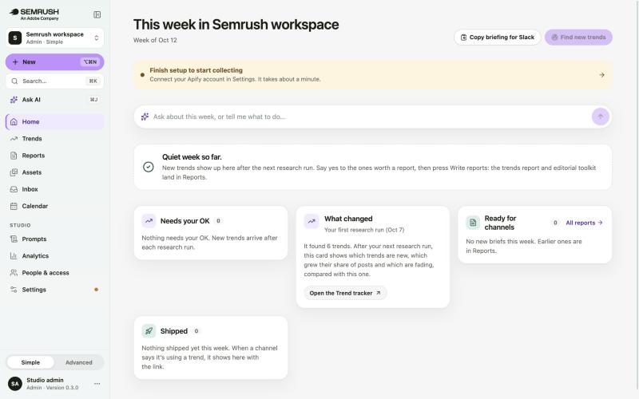
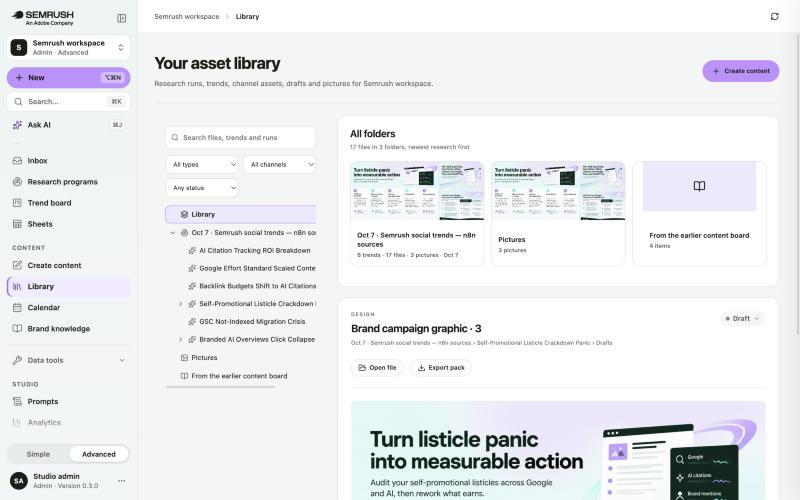
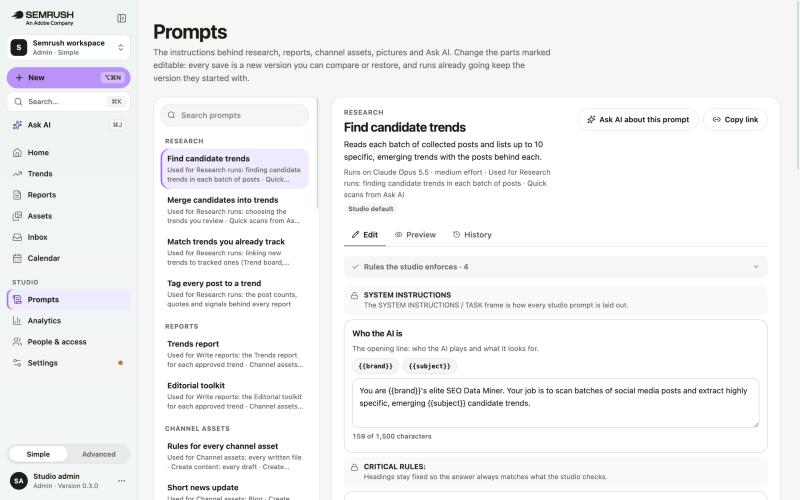

# Scraper Studio

A social-listening research and content studio for a marketing team. It collects public posts from X, LinkedIn and
Reddit through Apify, uses Claude to find the trends in them, lets the team approve the ones worth covering, writes an
evidence-backed trends report and editorial toolkit for each, and turns any report into a full set of channel assets.
It runs as a desktop app (one person, local data) on macOS, with an unsigned Windows 10/11 build in testing, and as a
shared browser studio with roles (Admin, Editor, Channel owner) enforced on the server.

**Status:** version 0.3.0, being handed to the Semrush dev team. What is verified and what isn't:
[HANDOFF.md → Status](HANDOFF.md#status).

| Home: the weekly briefing | Library tree (Advanced) | Prompt Library |
| --- | --- | --- |
|  |  |  |

## Quickstart

```bash
nvm use && npm ci       # Node 24
npm test                # offline; never spends money
npm run dev             # the desktop app (downloads Electron the first time)
```

On Windows, install Node 24 and run `npm ci`, `npm test` and `npm run dev` in PowerShell; see
[HANDOFF.md → Quickstart](HANDOFF.md#quickstart-for-a-new-developer).

The browser studio on your machine (the secrets go in through standard input, never the environment):

```bash
npm run build:web
(umask 077; printf 'STUDIO_SECRET_KEY=%s\nSTUDIO_PASSWORD=%s\n' "$(openssl rand -hex 32)" 'a-long-admin-password' > ~/.scraper-studio-secrets)
STUDIO_DATA_DIR=~/.scraper-studio-web STUDIO_SECRETS_FD=0 npm run start:web < ~/.scraper-studio-secrets
```

Open http://127.0.0.1:4174 and sign in under **Admins**. Save API keys in Settings. For a real deployment use
[docs/web-deploy.md](docs/web-deploy.md) and the kit in [deploy/](deploy/README.md), not a `docker run` with secrets in
the environment.

## Commands

| Command | What it does |
| --- | --- |
| `npm run dev` | The desktop app with hot reload |
| `npm run start:semrush` | Build, then open the Mac app in the Semrush workspace |
| `npm test` / `npm run test:coverage` | Vitest / with coverage |
| `npm run lint` | ESLint |
| `npm run check` | Lint, tests and the browser build |
| `npm run build` / `npm run build:web` | Desktop bundle / browser bundle |
| `npm run start:web` | The browser studio server (`scripts/studio-web.cjs`) |
| `npm run test:desktop` | Desktop smoke test (after `npm run build`) |
| `npm run dist:mac` | Universal (Apple silicon + Intel) DMG; the release build |
| `npm run dist` | A DMG for this Mac's architecture only |
| `npm run dist:win` | Windows x64 installer, unsigned: `dist/Scraper-Studio-<version>-Windows-x64.exe` ([RUNBOOK.md](RUNBOOK.md#release-the-windows-app); on Apple silicon it needs Rosetta) |
| `npm run pack` | An unpacked app in `dist/` |
| `npm run preview` | Build and open the built app |
| `npm run icons:mac` | Regenerate the macOS icon |
| `npm run release:diagnostics` | Meant to list what a release build contains; fails today ([HANDOFF.md](HANDOFF.md#cleanup-dependencies-and-release)) |
| `npm run backup` / `npm run restore` | Back up or restore a studio data folder |

## Read next

- [HANDOFF.md](HANDOFF.md): the entry point: features, configuration, data, costs, follow-ups, decisions.
- [ARCHITECTURE.md](ARCHITECTURE.md): how the pieces fit and where to extend them.
- [RUNBOOK.md](RUNBOOK.md): release, deploy, back up, upgrade, recover.
- [SECURITY.md](SECURITY.md): trust boundaries, data flows, hardening, known gaps.
- [CONTRIBUTING.md](CONTRIBUTING.md): change checklists, tests and conventions.
- [CHANGELOG.md](CHANGELOG.md): what shipped when.
- [docs/app-guide.md](docs/app-guide.md): every page and control (Ask AI answers from it).
- [docs/web-deploy.md](docs/web-deploy.md) and [docs/roles-and-access.md](docs/roles-and-access.md).
- [docs/README.md](docs/README.md): everything else under `docs/`.

## Ownership

`package.json` marks the project `UNLICENSED` and private. Ownership, licence, signing identity and where the
repository lives are open decisions for Semrush: [HANDOFF.md → Decisions](HANDOFF.md#decisions-semrush-must-make-before-go-live).
To package the source, use `scripts/make-handoff.sh` (it archives a git commit and checks it for secrets); never zip
the working folder.
