# Scraper Studio design review: October 2026

**Scope:** every screen in the Simple and Advanced layouts, reviewed as a product designer and as a front-end and platform engineer.

**Method:**
- Screenshots were taken from the browser studio running on a copy of the live workspace, with AI turned off.
- Five parallel code audits traced every observation to a file and line.

**Where the work lives:**
- What was built: [`SPEC.md`](SPEC.md).
- Screenshots: [`screens/`](screens/). They show the app **before** the redesign.

## Summary

The studio does the hard part well. It runs a research pipeline that replaces the Golden Thread n8n workflows end to end, with real cost controls and role-based access. Its weaknesses are continuity and structure.

- **Ask AI forgets.** Each session starts blank. It can't size a scan to a request or summarize what it collected.
- **Output piles up flat.** Every report, toolkit, kit file and picture lands in one list.
- **Trends have no memory across runs.** Every run's trends look new, so the team can't see what is rising or fading.
- **The two layouts drift.** They use different words for the same things, and the Advanced layout offers 18 pages and a chat that can't act.

The redesign answers each weakness:

| Gap | Change |
|---|---|
| Chat forgets | Server-stored conversations per person, long-term memory with recall, a rolling summary, and searchable past conversations |
| Chat can't scrape on request | Quick scans: Ask AI turns "small, cheap, last few hours" into a sized, priced plan (platforms, accounts, posts, comments, hours, caps) that the person approves in one click |
| Answers are prose only | A grounded card library: trends, reports, folders, live runs, programs, metrics, charts, tables, checklists, comparisons, real posts, a scan planner and memory chips. Numbers come from studio state, never from the model |
| Library is one flat list | A folder tree: Research run → Trend → Report and toolkit, Channel assets by team, Drafts, Pictures. Breadcrumbs, folder cards, search and filters in both layouts |
| Trends reset every run | The Trend tracker links the same trend across runs and quick scans: momentum (new, rising, steady, fading), a timeline, weekly snapshots and category momentum, plus a "What changed" card and a digest that keeps Ask AI current |
| Layout drift | One vocabulary, a regrouped Advanced sidebar, a "Back to Simple" bar, a command palette in both layouts, and Ask AI actions in both layouts |

## Screen-by-screen findings

### Simple layout

| Screen | Before | Finding | Change |
|---|---|---|---|
| Home | 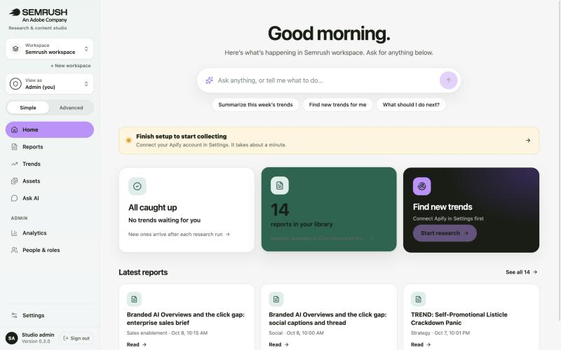 | The reports tile counted 12 "reports" for 6 trends, because each trend has a report and a toolkit. On hover, the green tile's "Newest: …" line dropped to about 1.2:1 contrast (a global `button:hover` won the cascade). Nothing said what changed since the last run. | Counts trends, not files. Hover contrast fixed at the root. A **What changed** card lists new, rising and fading trends since the last run. |
| Reports | 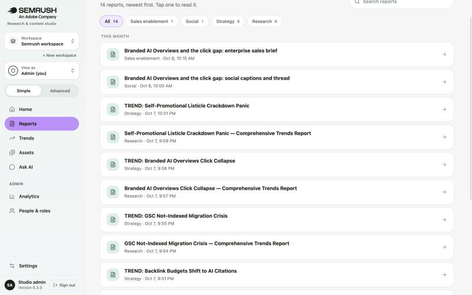 | "TREND: X" and "X — Comprehensive Trends Report" appeared as separate rows, filtered by internal channel names ("Research", "Strategy"). | Grouped by research run, one row per trend, with a "Trends report \| Editorial toolkit" switch in the reader, a breadcrumb, and a link to that trend's channel assets. |
| Report reader | 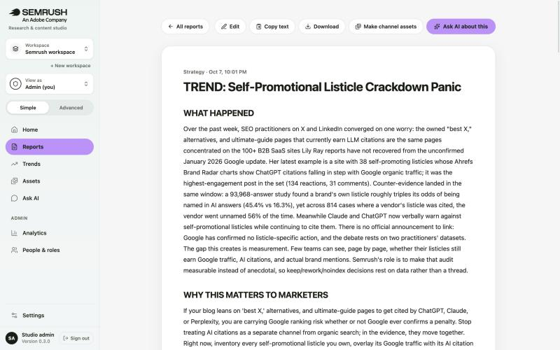 | Strong reading experience, but no route to the trend's assets or its history. | Adds a breadcrumb, a **Channel assets (N)** link and the trend's momentum. |
| Trends | 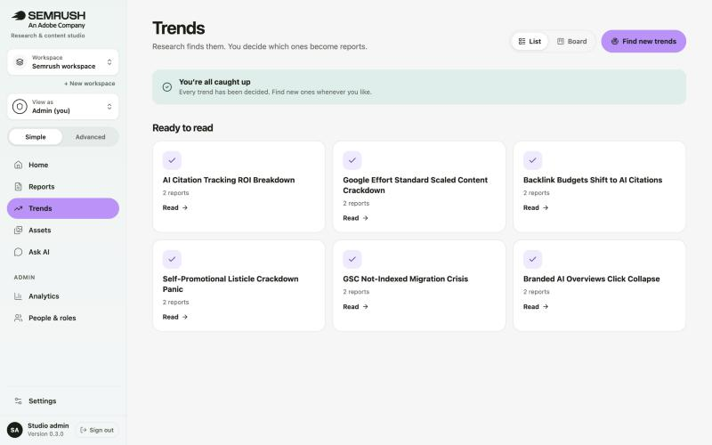 | "Find new trends" always used the first program. The empty state had no button. Board columns said "Nothing here". | Same program picker as Home, a real call to action, momentum badges, and column text that says what comes next. |
| Assets | 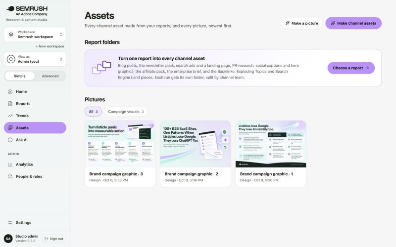 | Kit folders were keyed by `sourceKey`, so one recurring trend's kits from different runs merged into one folder. Channel teams were grouped by display text. | Folders by research run and trend, kits placed by the report they used, channels grouped by deliverable id. |
| Ask AI | 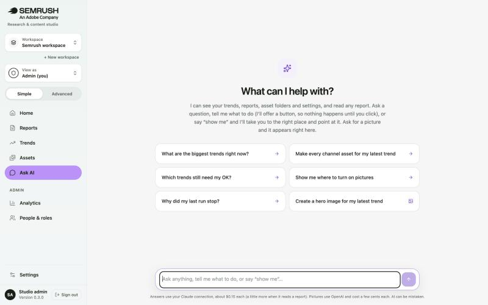 | The conversation was lost on reload, on a layout switch and on a role change. It could not scrape on request or remember preferences, and replies were prose plus buttons. | Conversation rail, memory panel, cards, quick-scan planner, and a Stop button. |
| Analytics | 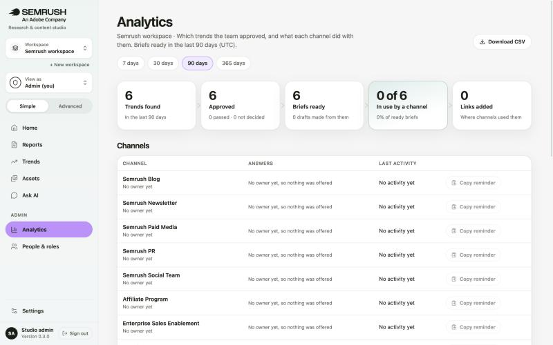 | Clear. No changes beyond hover contrast. | — |
| People & roles | 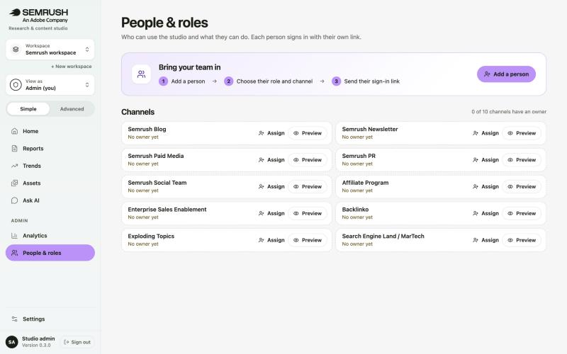 | Clear. | — |
| Settings | 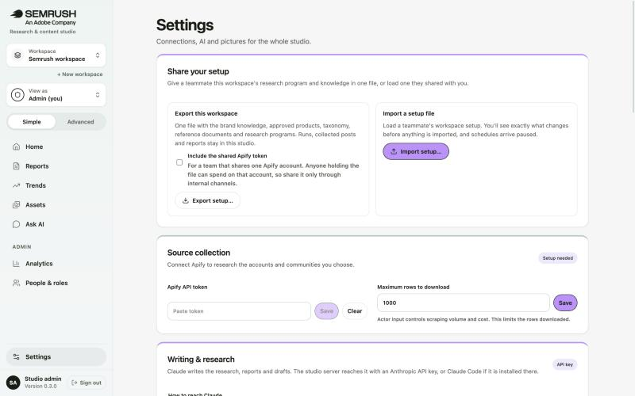 | Opened with "Share your setup" above the missing Apify connection, whose badge was neutral grey. Placeholders said "this device" on the web. "Clear" was enabled when nothing was saved. Diagnostics promised a check with no button. | Reordered (Source collection first, warning badge), web-aware copy, Clear disabled when empty, **Check connections** button. |

### Advanced layout

| Screen | Before | Finding | Change |
|---|---|---|---|
| Overview | 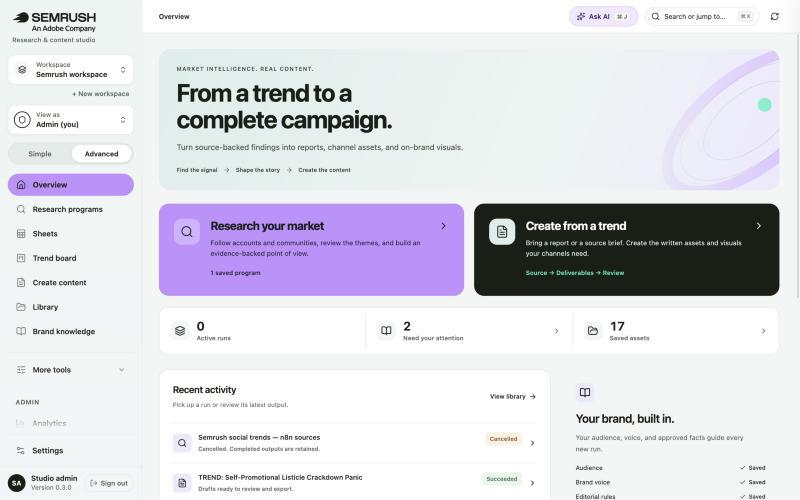 | The "Recent activity" panel listed runs, but its button said "View library". | The button matches the panel. |
| Research programs | 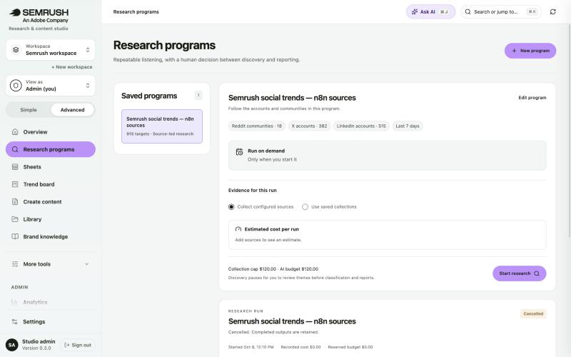 | "Add sources to see an estimate" appeared for a 915-target program. The loading state was mislabeled as empty, and a late response could overwrite a newer one. Starting a run asked no cost question. | Loading, idle and ready states with a stale-response guard. Every start confirms the real estimate against the caps. Quick scans are listed and labeled. |
| Trend board | 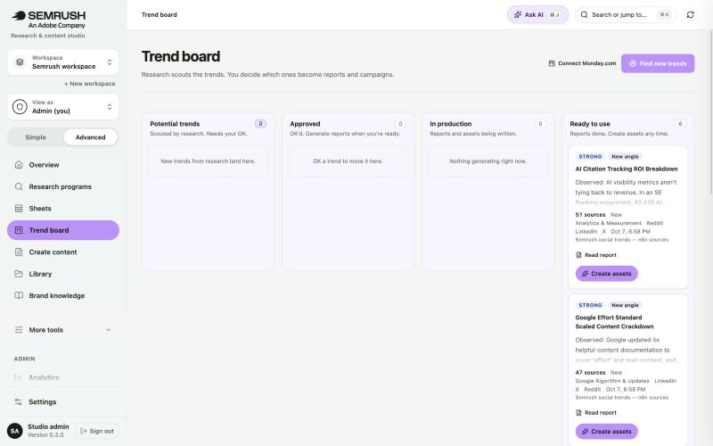 | Different words from Simple (Approve/Pass vs Yes/Skip, "Generate reports" vs "Write the reports"). Cards for the same trend from different runs had no link between them. | One vocabulary, momentum badges, and column text that says what comes next. |
| Create content | 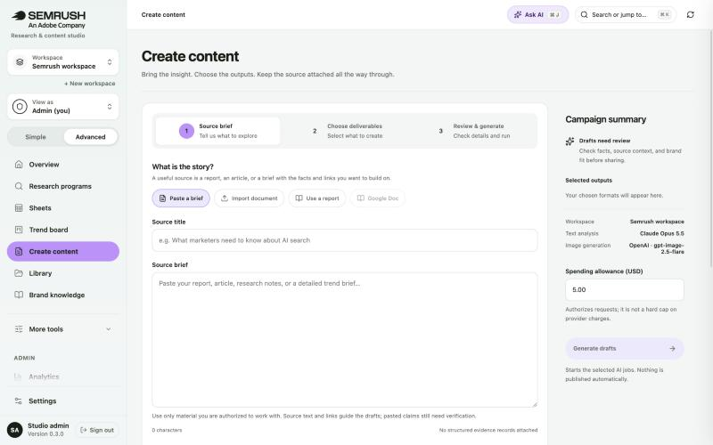 | Solid. | — |
| Library | 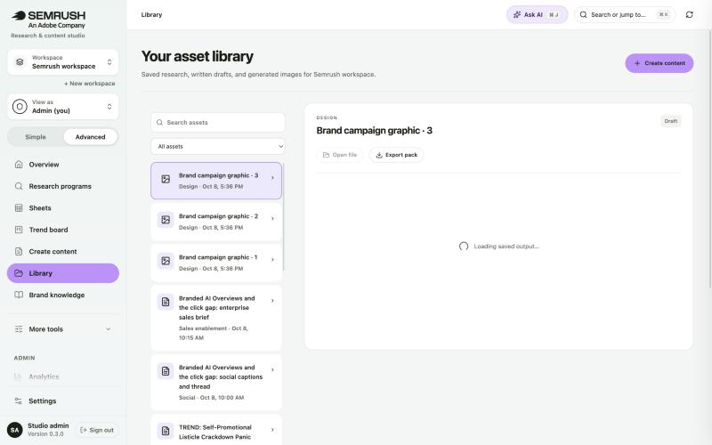, 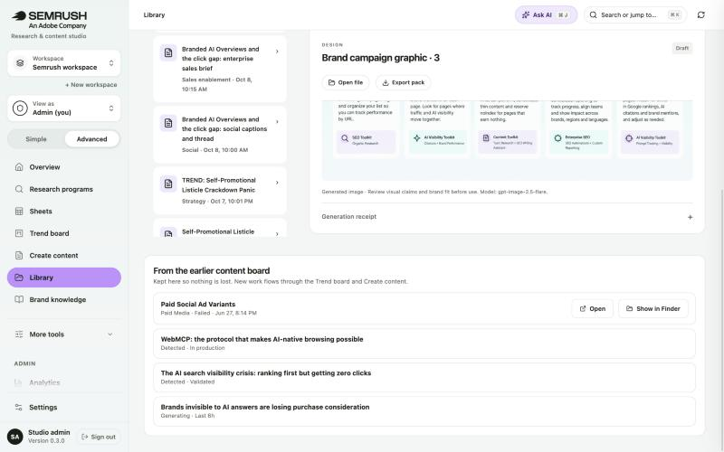 | A flat list of every file and picture. Search covered title and channel only. The badge always said "Draft". The preview didn't refresh after an edit. Export differed from Simple. | Tree, breadcrumbs, folder cards, filters and flat search results with their paths. The preview refreshes on edit, the badge shows the review status, and **Save folder** matches Simple. |
| Brand knowledge | 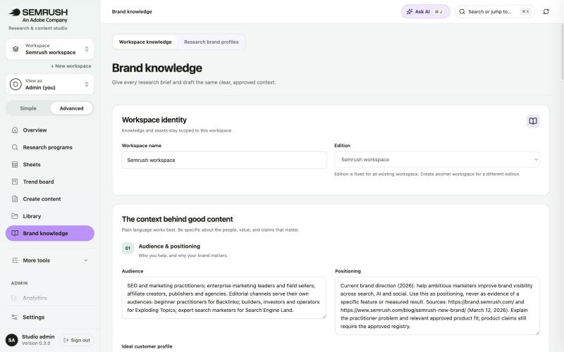 | Clear. | — |
| Sheets | 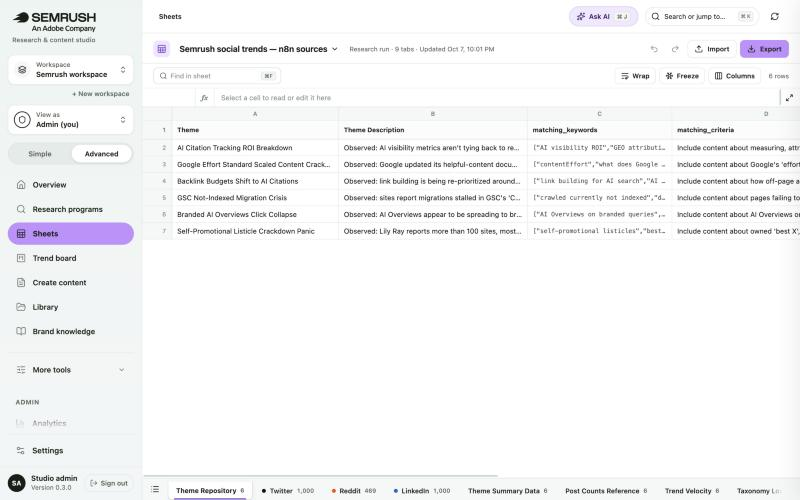, 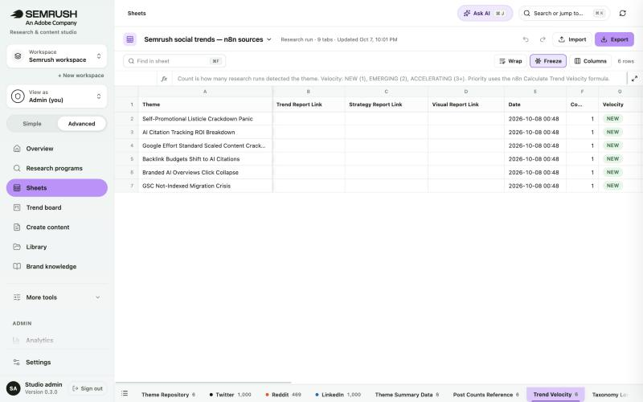 | Trend Velocity showed Count 1 for every trend and empty report links, with no explanation. No sheet tracked trends across runs. | The **Trend tracker** workbook (timeline, weekly snapshot, category momentum, run log) is listed first. Trend Velocity counts runs from the tracker, names each report, and explains blank Drive links. |
| More tools | 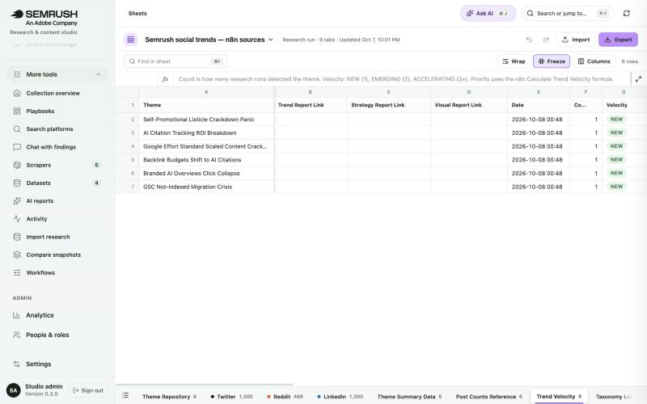 | 7 main pages plus 11 in "More tools". Two chats. Repeated icons. | Research / Content groups plus a remembered **Data tools** group (Collect, Analyze, Automate). "Chat with findings" becomes **Ask your datasets** and "AI reports" becomes **Dataset reports**. |
| Ask AI drawer | 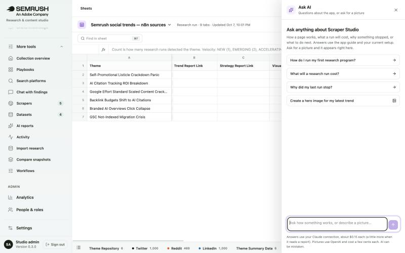 | Could not offer action buttons or Show me. | Same actions, cards, memory and history as Simple. |

## Engineering findings that shaped the build

- **History was authored by the client.** The server trusted assistant turns sent by the page. History is now stored and authored on the server.
- **Ask AI could not be stopped.** It now registers a cancellable job.
- **Cost.** About 80 KB of guide was resent on every question. On the API-key route the stable prefix is now prompt-cached.
- **Theme ids are scoped to a run.** The AI matcher only links exact-same topics, so cross-run identity needs the deterministic linker in `trend-history.js`.
- **Day-level windows.** Research windows were whole UTC days, so "last few hours" was impossible. Hour-level windows were added without changing saved programs.
- **Quick scans spend nothing on reviews or reports.** They stop after themes, and Ask AI summarizes from the collected posts.
- **Folder grouping existed in three copies.** It now has one pure module (`library-tree.js`). Channel data moved to JSON so the renderer and main share it.

## Open questions for the Semrush team

1. Should themes from quick scans count toward momentum the same way research runs do, or only as "pulse" observations? The build labels them `quick-scan` and includes them.
2. Should admins be able to read other people's Ask AI conversations? The build says no. Memory scoped to "workspace" is still per person.
3. Web sign-in with the shared admin password maps everyone to one identity (`owner`), so those people share one history. Personal sign-in links or SSO give each person their own memory.
4. When the AI matcher misses a recurring trend, should the deterministic linker also feed back into the research run? That would change paid-run behaviour, so it is left as a recommendation.

## After the redesign

These screenshots come from the browser studio running on the same copy of the workspace, with AI turned off. They cover both waves: [`SPEC.md`](SPEC.md) and [`SPEC-2.md`](SPEC-2.md).

| Screen | After |
|---|---|
| Home (Simple): weekly briefing |  |
| Home (Advanced): same briefing, new sidebar | 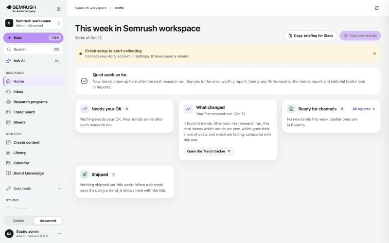 |
| Trends | 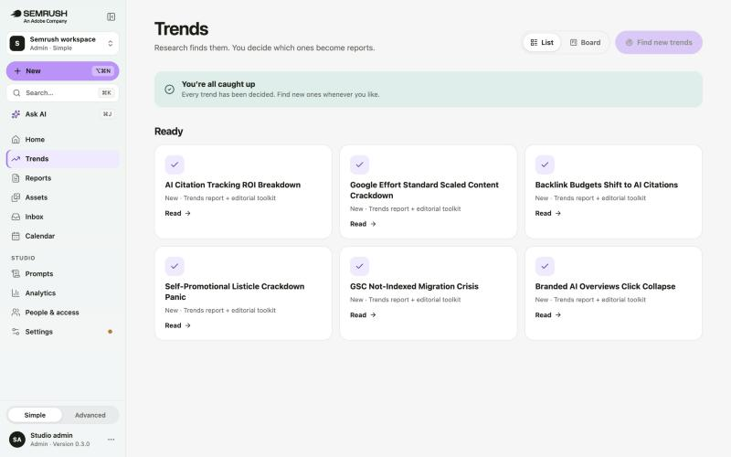 |
| Reports, one row per trend | 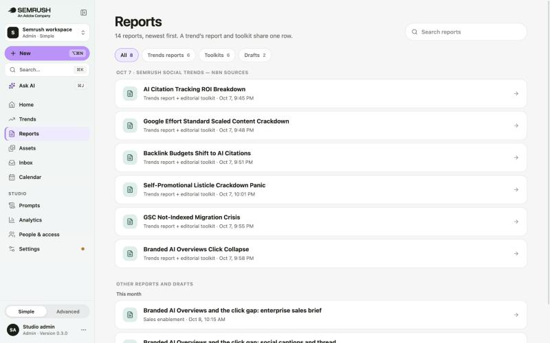 |
| Assets, research-run folders | 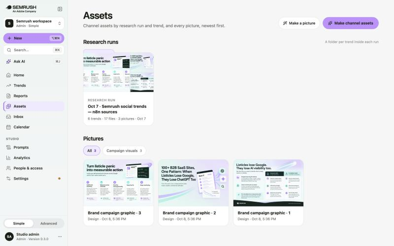, 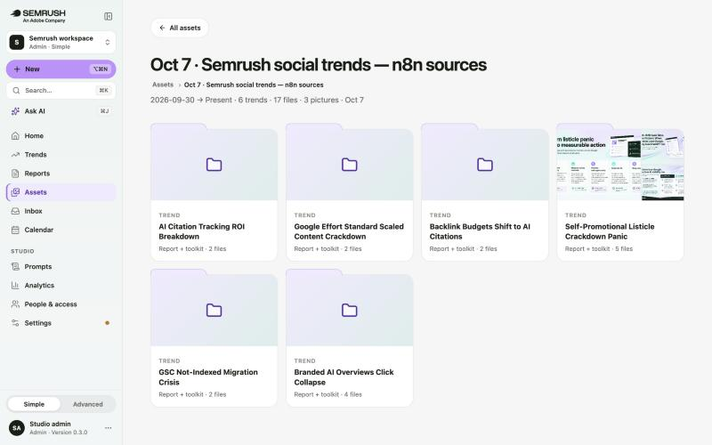 |
| Ask AI, saved conversations and memory | 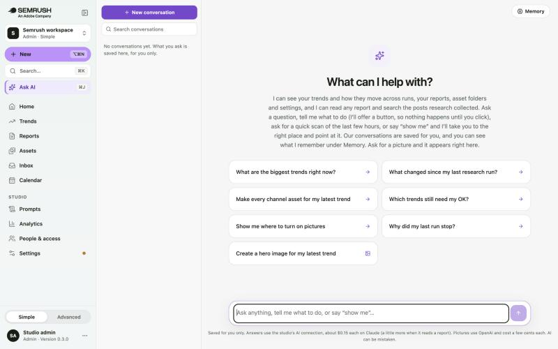 |
| Inbox | 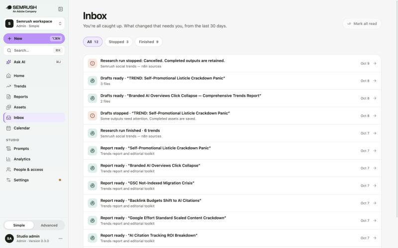 |
| Calendar | 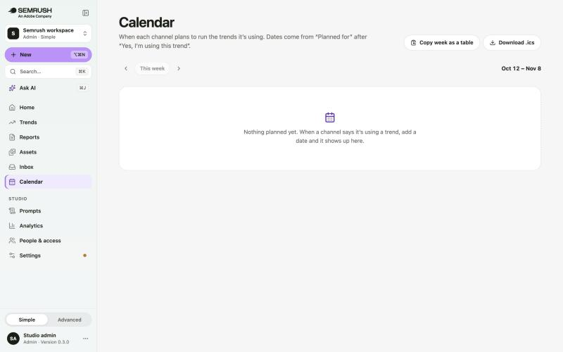 |
| Prompts |  |
| People & access: Roles and People | 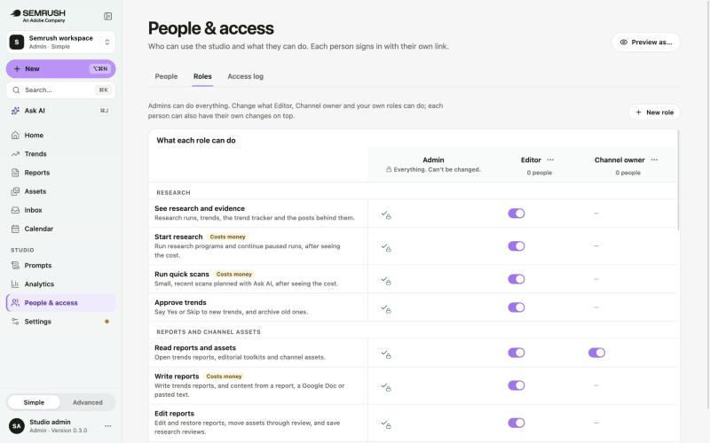, 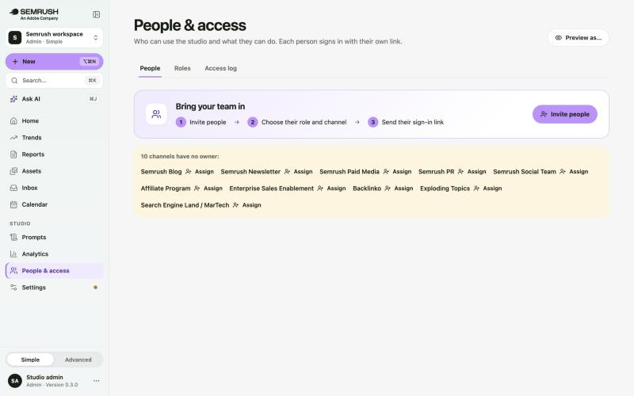 |
| Library tree (Advanced) |  |
| Sheets: Trend Velocity explained, Trend tracker | 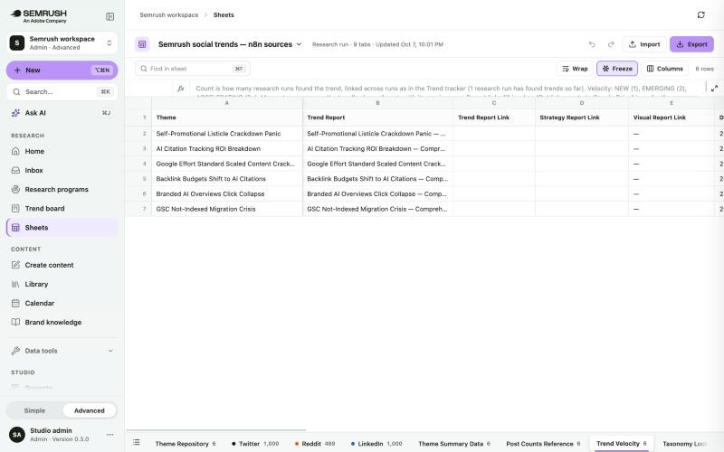, 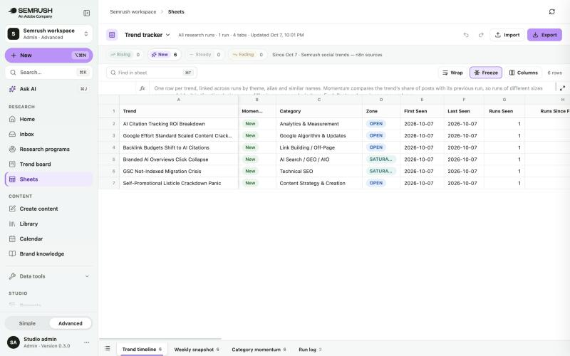 |
| New menu and icon rail | 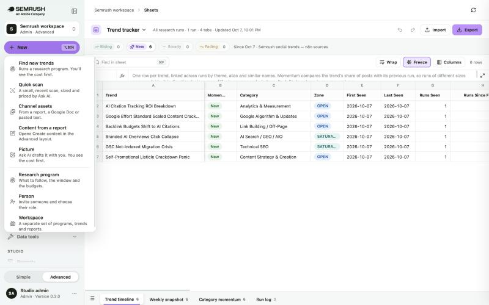, 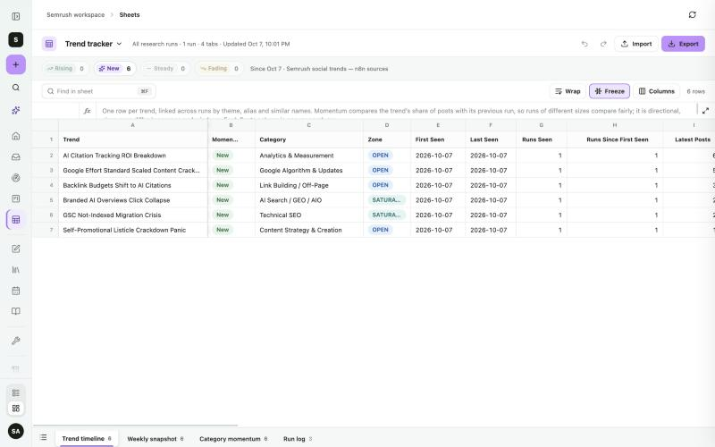 |

## Verification status (for the handoff team)

What was checked:
- `npm run build` and `npm run build:web` both pass.
- `node scripts/prompt-goldens.mjs --check` reports 99 cases and 0 differences. The 8 Ask AI goldens were regenerated on purpose, for the new layout wording. The other 91 are byte-identical to before the prompt refactor.
- Static invariants hold:
  - every method has a preload entry and a handler;
  - every method sits in exactly one capability;
  - every renderer `api.X` exists;
  - `copy-main-modules.mjs` covers every file main requires.
- An adversarial review across security, contracts, data, AI routes, UX and regressions found 28 issues. 25 were confirmed and fixed; 3 were refuted.

What was not checked:
- **The vitest suite was not run.** Many suites were updated or added and checked against a stand-in runner, but several older expectations will still fail until they are refreshed for the new nav, Reports grouping and confirmation wording. Run `npm test` first.
- No AI or Apify calls were made. The sandbox had AI blocked, so quick scans, prompt test runs and Ask AI answers still need checking against a real Claude route, an API key and Codex.
- The X operator `since_time:` used for hour-level quick-scan windows has not been tried on a live run.
- Dark mode is defined in tokens but not switched on anywhere yet.
